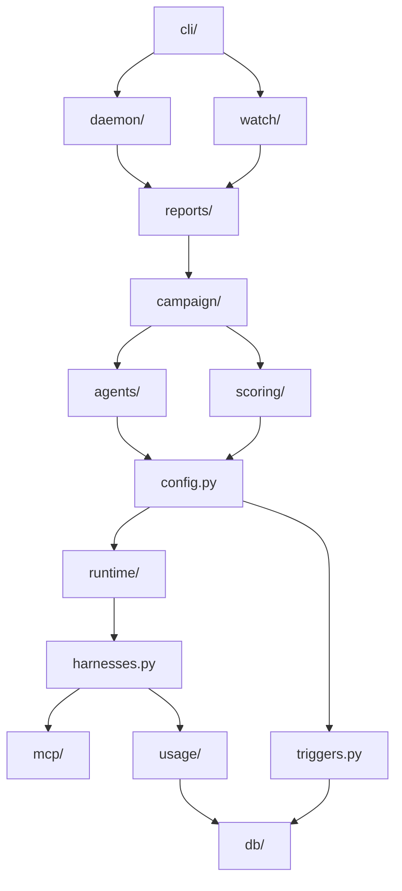

The `piloop` package has one subpackage for each concern. Imports only point down this list:

1. `db/`: storage, the SQL gate for agents, the events feed.
2. `mcp/`, `usage/`, and `config.py` with `harnesses.py`: MCP servers, token usage, the project configuration.
3. `runtime/`: where the agent processes run (a background process, or a Herdr pane).
4. `scoring/`: the evaluate command, the ledger, the verdict.
5. `agents/`: the roles and their prompts, the agent lifecycle, session capture.
6. `campaign/`: projects, ideas, the inbox, stop conditions, the spend limit.
7. `reports/`: status, history, the research pack.
8. `daemon/`: the process, the scheduler, the run executor.
9. `watch/` and `cli/`.

The rule is also in [CONTRIBUTING.md](https://github.com/hiloopai/piloop/blob/main/CONTRIBUTING.md#package-layout). When a
module needs code from a higher layer, move that code down.

The graph below is generated from the import statements in `piloop/`. An arrow points from the importer to what it
imports. An arrow that a longer path already implies is left out, so the layers show. The table after the graph has
every direct import.

{/* Generated by scripts/gen_docs.py up to the end marker. Do not edit this part: run `make docs`. */}

The graph leaves out the shared modules `deprecated.py`, `git.py`, `otel.py`, `proc.py`, `settings.py`, `text.py`. Every layer may import them.

| Subpackage or module | Imports directly |
|---|---|
| `agents/` | `config.py`, `db/`, `git.py`, `harnesses.py`, `mcp/`, `otel.py`, `proc.py`, `runtime/`, `settings.py`, `text.py`, `usage/` |
| `campaign/` | `agents/`, `config.py`, `db/`, `git.py`, `proc.py`, `scoring/`, `settings.py`, `text.py`, `usage/` |
| `cli/` | `agents/`, `campaign/`, `config.py`, `daemon/`, `db/`, `deprecated.py`, `git.py`, `mcp/`, `proc.py`, `reports/`, `runtime/`, `scoring/`, `settings.py`, `text.py`, `watch/` |
| `config.py` | `db/`, `deprecated.py`, `harnesses.py`, `mcp/`, `runtime/`, `triggers.py` |
| `daemon/` | `agents/`, `campaign/`, `config.py`, `db/`, `git.py`, `otel.py`, `proc.py`, `reports/`, `runtime/`, `scoring/`, `settings.py`, `triggers.py`, `usage/` |
| `db/` | `proc.py` |
| `deprecated.py` | nothing |
| `git.py` | nothing |
| `harnesses.py` | `mcp/`, `usage/` |
| `mcp/` | nothing |
| `otel.py` | `settings.py` |
| `proc.py` | nothing |
| `reports/` | `agents/`, `campaign/`, `config.py`, `db/`, `git.py`, `runtime/`, `scoring/`, `text.py`, `usage/` |
| `runtime/` | `db/`, `harnesses.py`, `proc.py`, `settings.py` |
| `scoring/` | `config.py`, `db/`, `git.py`, `proc.py`, `text.py` |
| `settings.py` | nothing |
| `text.py` | nothing |
| `triggers.py` | `db/` |
| `usage/` | `db/`, `settings.py` |
| `watch/` | `campaign/`, `config.py`, `db/`, `reports/`, `runtime/`, `scoring/`, `text.py`, `usage/` |

{/* End of the generated part. */}
