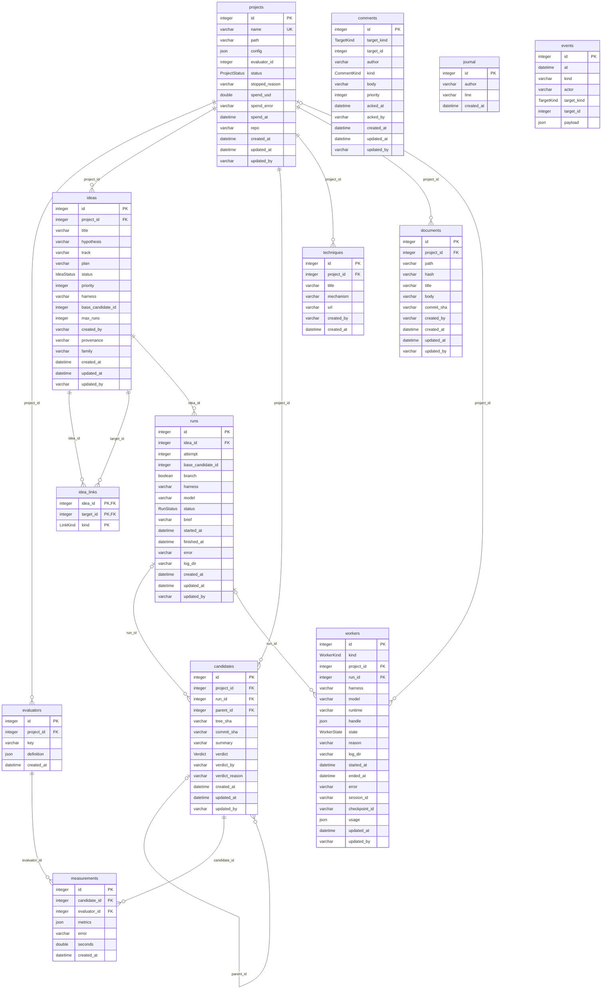

The database is the contract between every actor: you, the orchestrator, the daemon and the agents. They all read and
write the same tables, with `piloop sql` or through the CLI. The rules live in the schema, not in an API: CHECK
constraints fix the allowed values, foreign keys and unique keys fix the relations, and triggers record who changed a
row and log each change in `events`.

- A **project** is one repo. It owns its ideas, its candidates and its evaluators. `piloop init` adds an evaluator
  row when the evaluate command, the metrics or `link` change.
- An **idea** is something to try. `idea_links` relates two ideas of one project: one runs `after` the other, or
  `supersedes` it. A track is not a table. `ideas.track` is the name of a track in `piloop.toml`.
- A **run** is one attempt at an idea. A **worker** row is one agent process. A run's worker row has its `run_id`.
- A **candidate** is a distinct state of the code. Its git tree identifies it, and `parent_id` is its lineage. A
  **measurement** is one run of an evaluator on a candidate.
- A **comment** or an **event** points at any row through `(target_kind, target_id)`, so it has no foreign key.
- A **technique** is an outside technique that a scout sweep found.

Three columns hold a candidate id or an evaluator id without a foreign key: `projects.evaluator_id`,
`ideas.base_candidate_id` and `runs.base_candidate_id`. The foreign keys would make a cycle, and SQLite cannot add a
foreign key to a cycle afterwards.

The diagram is generated from the models in `piloop/db/models.py`. Each line is a foreign key, labeled with its column.
The [database schema](/reference/schema) has the full DDL with the indexes.

{/* Generated by scripts/gen_docs.py up to the end marker. Do not edit this part: run `make docs`. */}

The full-text indexes are not in the diagram: `ideas_fts` (`title`, `hypothesis`, `plan`), `comments_fts` (`body`), `documents_fts` (`title`, `body`).

{/* End of the generated part. */}
