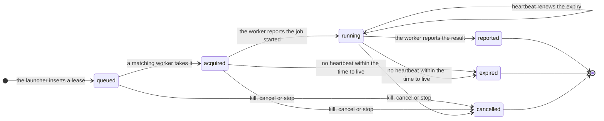

<Warning>
  Proposal. Nothing on this page is built yet. The operations, keys and commands that it names do not exist in piloop
  today, and their spelling is settled in the pull requests that implement them. The current interfaces are in
  [Extension points](/architecture/extension-points).
</Warning>

## Decisions

| # | Decision | Choice | Why |
|---|---|---|---|
| D1 | Execution path | Every job goes through a lease, local jobs included. Locally, an in-process worker takes them. | One execution path. Local is the hosted path with no network. |
| D2 | Database | One SQLite file per deployment, one writer: the control plane. | Cross-campaign memory stays plain SQL. Every table already has its project, so a later split is mechanical. |
| D3 | Tenancy | One deployment serves one team. | Internal use comes first. Multi-tenancy is deferred. |
| D4 | Remote agents' writes | `piloop sql` relays the statement to the control plane, which runs it through the same authorizer as locally. | It is the simplest path, and agents keep one interface. Restrict writes to operations later only if they cause problems. |
| D5 | First remote transport | HTTP and server-sent events, reached through an SSH tunnel before tokens exist. | One listener, and no new exposure at first. |
| D6 | Steering remote work | Each worker opens a live stream (SSE or WebSocket) to the control plane. The server pushes prompts, kills and cancels on it at once. Heartbeat answers are the fallback. | Push semantics without an inbound port on any worker. |
| D7 | Partition | A worker that hears nothing for a grace period (10 minutes by default) stops its jobs. Fencing refuses its late report. | A partitioned worker and its replacement do not both spend scarce subscription quota. |
| D8 | Evaluation in flight | The lease row records it. A measurement is written once, when the evaluation ends. | Measurements stay immutable. |
| D9 | Model access | A seam per worker. Providers: the host's harness logins (the local default), a model gateway (the hosted default; the worker holds a scoped token), and API keys from a secrets command. | The control plane never stores a model credential. |
| D10 | Orchestrator | An optional built-in role, off by default, launched on a worker. | Roles, triggers and the journal exist already. |
| D11 | Capacity and limits | Host and deployment capacity in `config.toml`; live overrides as rows; project limits in `piloop.toml`. | Capacity belongs to hosts, not projects. |
| D12 | How code moves | Git bundles, the git-tree artifact kind's transfer, through the storage backend. | One transfer path and one auth path. |

Everything within reason is configurable, with sensible defaults. The numbers on this page are defaults.

## Principles

1. **Local is the product.** The local configuration needs no server, account, token or network.
2. **The control plane decides, workers do.** The control plane holds state, planning, judgment and the event log.
   Workers run agents and evaluations on the machines that hold the logins and the compute.
3. **Workers open every connection.** Work comes on leases. Steering comes on the worker's own stream.
4. **One writer.** Nobody opens the SQLite file over a network. Everyone else goes through the control plane.
5. **One set of operations.** The CLI, agents, workers and remote clients call the same operations. A transport is an
   adapter and never owns a mutation.

This page uses the vocabulary of the shared plugin architecture proposal: capability,
provider, operation, fact, query, campaign type, and a measurement as an **evaluator** running a **benchmark** on an
**artifact**. Its migration steps are called plugin slices. This page adds a **worker** (a process that takes jobs and
runs them with a local runtime), a **lease** (the right to run one job, for as long as the worker heartbeats), and a
**label** (a host property that a job can require, such as `gpu`).

## Two configurations

| Concern | Local (the default) | Hosted (one team) |
|---|---|---|
| Processes | `piloop serve` with an in-process worker. | The control plane in a container, and `piloop worker` on each worker host. |
| State | SQLite in `$PILOOP_HOME`. | The same file on the control plane's volume. |
| The CLI | Runs operations in-process. | With `PILOOP_SERVER` set, sends them over HTTP. |
| Jobs | Leases taken by the in-process worker, run with `subprocess`, `herdr` or a package's runtime. | Leases taken by remote workers, run with their own local runtimes. |
| Code | The project checkout and its worktrees. | The repo of record on the control plane. Workers keep clones and exchange git bundles. |
| Artifacts | The local store, with an optional backend. | The same store with a remote backend. Workers upload through the control plane. |
| Identity | The OS user. `PILOOP_ACTOR` labels writes. | Scoped bearer tokens. The actor comes from the token. |
| Model access | The host's harness logins. | A model gateway or API keys on each worker. Usage is recorded per agent and per worker. |
| Network | None. | Outbound HTTPS from workers and clients, including each worker's stream. No inbound port on workers. |

## The seams

| Seam | Local provider | Hosted provider |
|---|---|---|
| Operations and event feed | In-process calls. `--json` and `--request-id` on the CLI, `piloop events --after <cursor>`. | `piloop serve --listen`: HTTP for operations, server-sent events for the feed. A reconnect sends `Last-Event-ID`. |
| Queries | `piloop sql` on the local file. | `piloop sql` relayed to the control plane, with the same authorizer, a row limit and a time limit. |
| Execution | The in-process worker. | Remote workers. |
| Evaluation | The in-process worker runs the evaluator. | An evaluation worker that supports the job's evaluator. |
| Capacity | `[capacity]` in `config.toml`: agents, evaluations, a memory floor, a load ceiling. | Each worker advertises its slots and sends a host sample with each heartbeat. |
| Artifact kinds and storage backends | Git trees on local disk. | Any kind on any backend. |
| Auth | The OS user. | Tokens, scoped `read`, `act`, `worker`, or per lease. |
| Model access | Harness logins. | A gateway token or API keys from the worker's secrets command. |
| Orchestrator | Your own agent with the `piloop-operate` skill. | The same through `PILOOP_SERVER`, or the optional built-in role. |

**Limits are data.** A `limits.set` operation changes a limit at one scope (deployment, project, role, harness, label
or worker), with a reason. It is a fact, it takes effect on the next tick, and `piloop status` shows each limit's
source. The control plane grants no lease to a worker above its load ceiling or below its memory floor.

**Artifacts.** An artifact kind says what an artifact is and how to materialize it: a git tree, a file, a theorem, a
dataset. A storage backend says where bytes live: local disk, S3, GCS, a content-addressed store, a git remote. Its
contract is `put`, `get`, `missing` and `list` by content hash. Any kind works with any backend. Content addressing
makes an upload by a stale worker harmless: nothing refers to a blob until an accepted report names it. Sealed
benchmark inputs are readable only with the token of an evaluation worker.

**Tokens.** `read` reads queries, the feed and unsealed artifacts. `act` adds operations. `worker` registers, takes
leases, heartbeats, reports and uploads. A lease token lets one agent act on its own run until the lease ends. A
reverse proxy with single sign-on can provide identity instead.

## Workers and leases

```text
piloop worker --server https://piloop.example.com --labels linux-x86 --evaluators process --agents 0 --evals 2
```

A worker registers with a stable id, its labels, its slots by job kind, its harnesses and their model access, the
evaluators that it supports, the repositories that it holds, its protocol version, and a host inventory. It then opens
its stream, takes leases, runs each job with a local runtime, and reports. It keeps a spool: running jobs' handles and
unsent reports, so a restarted worker re-attaches and resends.

A job names the artifact to materialize (kind and content hash), its inputs by hash, the paths to return, and the
names, never the values, of its secrets. An evaluation job names an evaluator, a benchmark and an artifact. A worker
matches a job when it has the required labels, the harness or the evaluator, a free slot, and a host sample within
limits. The most urgent job goes first, in the order that the scheduler and the
[evaluation queue](/concepts/verdict#the-evaluation-queue) compute. A secondary evaluation is an ordinary evaluation
job at a lower priority.



| Step | What happens |
|---|---|
| Enqueue | The launcher inserts the lease in the same transaction as the run's or evaluation's intent. The lease id is the job's handle. Nothing exists outside the database yet. |
| Acquire | The worker calls `lease.acquire`. One SQLite transaction picks a matching job, records the worker, sets the expiry, and returns the job and a lease token. |
| Start | The worker fetches missing commits and inputs, materializes the artifact, starts the job, and reports `started`. A job that cannot start is not an attempt. |
| Steer | `prompt`, `kill` and cancel reach the worker on its stream at once. The worker reports each message delivered or not. |
| Heartbeat | Status, an output tail per agent, and a host sample. The answer renews the expiry, or says `revoked`. |
| Report | The worker uploads the blobs, then calls `lease.report` with their hashes, usage and exit status. The control plane imports the bundle and continues as today: pin, measure, judge. |
| Expire | On the scheduler tick, a lease past its expiry becomes `expired`. No new loop. |

Defaults: heartbeat every 15 s, time to live 120 s, a start deadline of 10 minutes, and a silence grace period of
10 minutes. The launcher's calls map onto the lease: `start` waits for `started`, `wait` waits for the end, `status`
and `read` return the last heartbeat, and `attach` works on the worker's host. Locally that host is this machine, so
`piloop attach` works as today.

**Fencing.** Every lease has an id that only grows and a secret token. A report, a heartbeat and every operation of a
lease's agent carry them. In the transaction that applies a report, the control plane checks that the lease is live
and is the newest lease of its job. Otherwise the report is refused with `stale_lease`. Its blobs stay in the store,
and a `lease.stale_report` fact names them, so a person can import a commit from it as a reference candidate. A report
is an operation with a request id, so a resent report applies nothing twice.

**What comes back.** The worker commits what the agent left uncommitted as a `recovered` commit, then returns the new
commits as a bundle with the session-capture refs. It stages out only the idea's workspace and the agent's research
directory; a write anywhere else is reported, never merged. The session file and the evaluation outputs go to the
store by hash.

**Evaluation isolation.** An evaluation worker supports at least one evaluator and has no agent slots. Benchmark files
and held-out data are fetched only by evaluation workers, into a cache readable only by the worker's OS user. Agents
cannot read the benchmark or signal its process. On one machine, run an evaluation worker as a second OS user against
a daemon that listens on `127.0.0.1`.

### Failure cases

| Case | Behaviour |
|---|---|
| A worker dies during a run | The lease expires. The run fails as `worker lost`. It is not an attempt, and its idea goes back to `ready`. |
| A worker dies during an evaluation | The lease expires. The evaluation is unmeasured and is queued again. Partial output is never scored. |
| A network partition | The lease expires and the job is queued again. After the silence grace period, the worker stops its jobs and spools what they made. Its late report is fenced and kept as a stale report. |
| A duplicate report | The first receipt is returned. Nothing applies twice. |
| The control plane restarts | It renews every live lease's expiry, so workers have a full period to reconnect. Workers retry with backoff within the grace period. Nothing is queued again only because of the restart. |
| A worker restarts | It reads its spool and re-attaches to its jobs. A job it cannot find is reported gone: a run fails as `worker lost`, an evaluation is unmeasured. |
| A worker cannot start a job | Not an attempt. The job is queued again. Repeated failures mark the worker unhealthy, with an anomaly fact. |
| No worker matches a job | The lease stays `queued`. `start` gives up after its deadline. `piloop status` shows the requirement that no live worker meets. |
| The store is unreachable | The worker keeps the result in its spool and reports only after every blob is stored. |

## One database per deployment

One SQLite file holds every campaign of a deployment, as today. A file per campaign joined with `ATTACH` makes a
campaign easy to move or delete, but SQLite attaches 10 files by default, a transaction across attached files is
atomic per file only in write-ahead-log mode, and every migration runs once per file. Revisit the split when one of
these is measured: the write-lock wait at p99 passes about 1 s, a campaign must be handed over or deleted as a unit,
or a backup takes longer than its interval. The query operation then hides the layout.

## Remote clients

A remote `piloop watch` keeps a local replica: a snapshot with its cursor, then the event feed. It renders from the
replica and fetches large items lazily by hash. Until every column that it shows has an authoritative fact, it
re-reads its visible view on a slow timer.

| At 300 ms round trip with 2% loss | Target |
|---|---|
| Scrolling and filtering | under 50 ms |
| A new event on screen | within one round trip plus 1 s |
| Resume after a 10-minute disconnect | under 2 s |

## Rollout

In every slice, a local user sees no listener, no token and no remote worker unless they opt in.

| Slice | Change | Acceptance gate |
|---|---|---|
| 1. Operations and event feed | Plugin slice 1: receipts, stale-state checks, the cursor-based event reader, the control verbs. | A separate process snapshots, follows events, submits work, and reconnects without loss or duplicates. |
| 2. Leases on one machine | The lease table, the in-process worker, fencing, the widened job description, evaluators on workers, `[capacity]`, host samples and `limits.set`. Every job goes through a lease. The direct dispatch from the launcher to local runtimes is deleted. | A runtime contract suite passes on `subprocess` and `herdr` behind the worker. Fault injection: `kill -9` of a worker during a run and during an evaluation, a late report, a duplicate report, a daemon restart, a partition past the grace period. Three projects on one host never exceed its capacity. A lowered limit holds on the next tick. |
| 3. HTTP, SSE, tokens and the worker stream | `piloop serve --listen`, scoped tokens, `PILOOP_SERVER`, the relayed `piloop sql`, the remote watch replica, and the worker stream. | Remote watch meets the latency targets. A prompt reaches a worker over its stream within one round trip. An evaluation worker under a second OS user measures a campaign whose agents cannot read the benchmark. |
| 4. Hosted service, one team | A container image and a deployment guide: SQLite and the repo of record on a volume, a remote storage backend, TLS at a proxy. Agents run in the container through a model gateway or API keys. | Start a campaign from a laptop, close the laptop, and it runs 24 hours with no manual kill and no raw SQL repair. |
| 5. Remote workers | Workers on other hosts, bundles both ways. | A second host runs workers. Power it off mid-run: the run goes back to the queue, and its late report is refused. |
| 6. The orchestrator role (optional) | A built-in `orchestrator` role, off by default. | A hosted campaign answers its escalations with no person's session open. |
| 7. Ephemeral workers (optional) | A worker provider that starts one sandbox per lease. | A sandbox lost mid-job gives an unmeasured result, measured again. |

### Owners and retirement conditions

| Addition | Owner | Deleted when |
|---|---|---|
| The lease table, the in-process worker and `piloop worker` | worker maintainer | Never: they are the execution path. The direct dispatch to local runtimes is deleted in slice 2. |
| Lease expiry in the scheduler tick | worker maintainer | With the lease table. It is not a separate loop. |
| The HTTP, SSE and stream adapter | integration maintainer | No supported client uses HTTP. |
| Tokens | integration maintainer | A fronting identity provider becomes the only supported way to authenticate. |
| The `piloop sql` relay | integration maintainer | Remote writes are restricted to operations, if they ever are. |
| `limits.set` override rows | scheduler maintainer | Limits become hot-reloaded configuration; deleted in that change. |
| The remote watch's re-read timer | watch maintainer | Every column that `watch` shows has an authoritative fact. |
| The `orchestrator` role | roles maintainer | No deployment enables it two minor releases after it ships. |
| Stale reports | campaign data | Only with their campaign. They are evidence. |
| The container image and guide | hosted maintainer | The hosted configuration is dropped. |

## Deferred

| Deferred | The seam it plugs into | Revisit when |
|---|---|---|
| Multi-tenancy | A tenant scope on tokens, and workers per tenant. | A deployment must serve parties that do not trust each other. |
| Wasm plugin components | A transport for pure plugins (evaluators, artifact kinds, planners, policies), on the same data-only contract as in-process Python. Some host plugins can follow, such as a storage backend over WASI HTTP. | A plugin must run untrusted code, or replay byte for byte across hosts. |
| A core in another language | The operations and their schemas. | The control plane is measured as the bottleneck. |
| A web UI | A client of the HTTP operations and the feed. | Remote watch is in use and its limits are known. |
| Another database engine | The query seam. | One writer cannot keep up with the measured write rate. |
| A push runtime over SSH | One more `Runtime` provider. | A team cannot run a worker process on its hosts. |

## References

- Martin Kleppmann,
  [How to do distributed locking](https://martin.kleppmann.com/2016/02/08/how-to-do-distributed-locking.html):
  leases and fencing tokens.
- The WHATWG HTML standard, [server-sent events](https://html.spec.whatwg.org/multipage/server-sent-events.html).
- SQLite: [limits](https://www.sqlite.org/limits.html), [write-ahead logging](https://www.sqlite.org/wal.html), and
  [SQLite over a network](https://www.sqlite.org/useovernet.html).
- [Buildkite agents](https://buildkite.com/docs/agent/v3): a hosted control plane with agents that poll for jobs.
