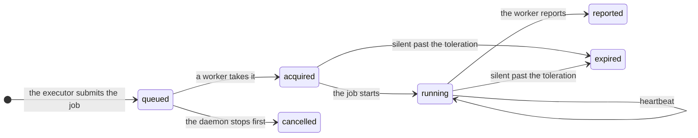

A **lease** is a time-limited claim on one job by one worker. Any [executor](/architecture/extension-points#executors)
can use leases: `Leases` in `piloop.capabilities`. The built-in `workers` executor runs every job on one.

| Word | Meaning |
|---|---|
| Job | One agent session or one evaluation: what to check out, what to run, what to bring back. |
| Worker | A process that takes leases and runs their jobs. `piloop serve` has one, called `local`. |
| Heartbeat | The worker renews its leases every `renew_seconds`. |
| Fencing token | The lease id. It grows with each new lease of a job, and a report with an old one is refused. |
| Revoke | A kill or a cancel: the heartbeat tells the worker to stop the job, and the job still reports. |

## A silent worker

The timing follows the two stages of Kubernetes, with its defaults. For `workers`, each number is a key of
[`[plugins.executor]`](/reference/configuration#plugins):

| Key | Default | Then | Kubernetes |
|---|---|---|---|
| `renew_seconds` | 10 | The worker sends a heartbeat. | The kubelet renews its node Lease every 10 s. |
| `grace_seconds` | 50 | The worker is unreachable and gets no new lease. | `--node-monitor-grace-period` |
| `toleration_seconds` | 300 | Its leases expire, and their jobs go back to the queue with a new token. | `tolerationSeconds` of the unreachable taint |

A worker that hears nothing back stops its own jobs two heartbeats before its leases expire, so a job never runs
twice.

| What happens | What piloop does |
|---|---|
| A worker dies during a run | The run ends `worker_lost`. It is not an attempt. |
| A worker dies during an evaluation | The evaluation is queued again. Partial output is never scored. |
| A late report | It is refused, and kept as a `lease.stale_report` event with the ref of its commits. |
| The same report twice | The second gets the first's answer. |
| The machine sleeps | A gap longer than the grace period is the daemon's own absence: nothing expires. |
| `piloop serve` restarts | Its worker finds its leases again and re-attaches to each agent whose worktree is there. |
