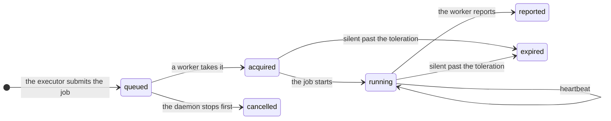

A **lease** is a time-limited claim on one job by one worker. Any [executor](/architecture/extension-points#executors)
can use leases: `Leases` in `piloop.capabilities`. The built-in `workers` executor runs every job on one.



| Word | Meaning |
|---|---|
| Job | One agent session or one evaluation: what to check out, what to run, what to bring back. |
| Worker | A process that takes leases and runs their jobs. `piloop serve` has one, called `serve`. |
| Pool | The slots and thresholds of each worker in it: `[plugins.executor.pools.<name>]`. |
| Heartbeat | The worker renews its leases every `renew_seconds`. |
| Fencing token | The lease id. It grows with each new lease of a job, and a report with an old one is refused. |
| Revoke | A kill or a cancel: the worker stops the job, and the job still reports. |
| Message | What a worker reads with a long-poll: a job waits, stop a job, or a prompt for an agent. The heartbeat is the fallback. |

## A silent worker

The timing follows the two stages of Kubernetes, with its defaults. For `workers`, each number is a key of
[`[plugins.executor]`](/reference/configuration#plugins):

| Key | Default | Then | Kubernetes |
|---|---|---|---|
| `renew_seconds` | 10 | The worker sends a heartbeat. | The kubelet renews its node Lease every 10 s. |
| `grace_seconds` | 50 | The worker is unreachable, and its slots count zero. | `--node-monitor-grace-period` |
| `toleration_seconds` | 300 | Its leases expire, and their jobs go back to the queue with a new token. | `tolerationSeconds` of the unreachable taint |

A worker that hears nothing back stops its own jobs two heartbeats before its leases expire, so a job never runs
twice.

## Capacity

A **pool** is the capacity of each worker in it: its slots, and the thresholds that keep jobs off a busy host, as in a
Kubernetes node pool. `piloop serve`'s worker is in the pool `serve`:

```toml
[plugins.executor]
provider = "workers"

[plugins.executor.pools.serve]
agents = 2          # no bound when unset
evaluations = 1     # 2 by default
max_load = 1.5      # the 1-minute load per CPU
min_memory_gb = 4
```

Each heartbeat carries a sample of the worker's host. A worker over `max_load` or under `min_memory_gb` takes no job,
and its slots count zero. The daemon launches an agent only into a free slot, and gives it to the campaign with the
fewest live agents. To change a pool's key while the daemon runs, set a **limit**. It wins over `config.toml` from the daemon's next
tick, and `piloop status` shows it with its reason:

```bash
piloop limits set executor.pools.serve.evaluations=1 --reason "the GPU trains a model"
piloop limits unset executor.pools.serve.evaluations
```

`piloop worker list` shows each worker, and why it got no lease:

```text
 worker  pool   seen    load     memory    disk      agents  evaluations  no lease
 serve   serve  4s ago  44.1/32  113.3 GB  918.4 GB  0       0            nothing
```

| What happens | What piloop does |
|---|---|
| A worker dies during a run | The run ends `worker_lost`. It is not an attempt. |
| A worker dies during an evaluation | The evaluation is queued again. Partial output is never scored. |
| A late report | It is refused, and kept as a `lease.stale_report` event with the ref of its commits. |
| The same report twice | The second gets the first's answer. |
| The machine sleeps | A gap longer than the grace period is the daemon's own absence: nothing expires. |
| `piloop serve` restarts | Its worker finds its leases again and re-attaches to each agent whose worktree is there. |
