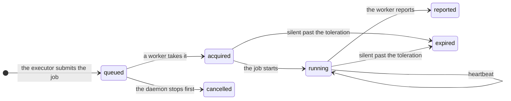

A **lease** is a time-limited claim on one job by one worker. Any [executor](/architecture/extension-points#executors)
can use leases: `Leases` in `piloop.capabilities`. The built-in `workers` executor runs every job on one.



| Word | Meaning |
|---|---|
| Job | One agent session or one evaluation: what to check out, what to run, what to bring back. It is a blob in the [CAS](/concepts/artifact-store), and its lease names it by address. It names no path: its commit, its inputs and its results go by address too. |
| Worker | A process that takes leases and runs their jobs. `piloop serve` has one, called `serve`. |
| Pool | The slots and thresholds of each worker in it: `[plugins.executor.pools.<name>]`. |
| Heartbeat | The worker renews its leases every `renew_seconds`. |
| Fencing token | The lease id. It grows with each new lease of a job, and a report with an old one is refused. |
| Revoke | A kill or a cancel: the worker stops the job, and the job still reports. |
| Message | An event that a worker reads after its cursor, with a long-poll: a job waits, stop a job, or a prompt for an agent. A restart of either side loses none. The heartbeat is the fallback. |

## A silent worker

The timing follows the two stages of Kubernetes, with its defaults. For `workers`, each number is a key of
[`[plugins.executor]`](/reference/configuration#plugins):

| Key | Then |
|---|---|
| `renew_seconds` | The worker sends a heartbeat. |
| `grace_seconds` | The worker is unreachable, and its slots count zero. |
| `toleration_seconds` | Its leases expire, and their jobs go back to the queue with a new token. |

A worker that hears nothing back stops its own jobs two heartbeats before its leases expire, so a job never runs
twice.

## Capacity

A **pool** is the capacity of each worker in it: its slots, and the thresholds that keep jobs off a busy host, as in a
Kubernetes node pool. `piloop serve`'s worker is in the pool `serve`:

```toml
[plugins.executor]
provider = "workers"

[plugins.executor.pools.serve]
agents = 2
evaluations = 1
max_load = 1.5      # the 1-minute load per CPU
min_memory_gb = 4
```

Each heartbeat carries a sample of the worker's host. A worker over `max_load` or under `min_memory_gb` takes no job,
and its slots count zero. The daemon launches an agent only into a free slot, and gives it to the campaign with the
fewest live agents. To change a pool's key while the daemon runs, set a **limit**. It wins over `config.toml` from
the daemon's next pass, and `piloop status` shows it with its reason:

```bash
piloop limits set executor.pools.serve.evaluations=1 --reason "the GPU trains a model"
piloop limits unset executor.pools.serve.evaluations
```

`piloop worker list` shows each worker, and why it got no lease:

```text
 worker  pool   seen    load     memory    disk      agents  evaluations  no lease
 serve   serve  4s ago  44.1/32  113.3 GB  918.4 GB  0       0            nothing
```

## A worker on another machine

`piloop worker` takes the leases of its pool over HTTPS. It reads and writes the CAS itself, and keeps clones of the
campaign's repo under its home, filled from the CAS. A new clone starts from a copy of the whole repo that the server
builds once per campaign, then takes only what is newer. [Workers on other machines](/guides/remote-workers) sets one up.

## Workers that the server starts

A pool with a **provisioner** starts its own workers when jobs wait, and stops them when they idle. The pool counts
the slots of its `max` workers, so its jobs wait on leases, and each waiting lease that no free slot takes starts a
worker. One that held no lease for `idle_seconds` is drained: it takes no more jobs, and the server stops it once it
holds none. One that cannot reach its server for `orphan_exit_seconds` exits by itself once it holds no job, so it never
outlives a stopped server.
[Workers that the server starts](/guides/remote-workers#workers-that-the-server-starts) sets a pool up.

## Faults

| What happens | What piloop does |
|---|---|
| A worker dies during a run | The run ends `worker_lost`. It is not an attempt. |
| A worker dies during an evaluation | The evaluation is queued again. Partial output is never scored. |
| A late report | It is refused, and kept as a `lease.stale_report` event. Its commits and logs stay in the CAS, by address. |
| The same report twice | The second gets the first's answer. |
| A report names blobs that the server's CAS lacks | The job is lost, with the blobs it names. |
| A worker stops or dies before it sends a report | The report waits in `$PILOOP_HOME/spool/<worker>`, and goes out when the worker starts again. |
| The server does not answer | The worker tries each call again. Its log says `worker.unreachable` at the first failure, then once a minute. |
| An agent runs `piloop` after its lease ended | The call is refused. |
| The machine sleeps | A gap longer than the grace period is the daemon's own absence: nothing expires. |
| `piloop serve` restarts | Its worker finds its leases again and re-attaches to each agent whose worktree is there. |
| A started worker does not register within `register_seconds` | It is stopped, and the pool waits 30 s, doubling to 10 minutes, before it starts another. |
| The platform refuses a start: a quota, no GPU | The pool backs off the same way. Three refusals in a row are an escalation in the inbox. |
| The platform loses a worker, or it goes silent | It is stopped. Its jobs come back as for any lost worker, and the pool starts another if they still wait. |
| The platform has a worker that the server has no record of | It is stopped. Two servers on one account never stop each other's: each tags its own. |
