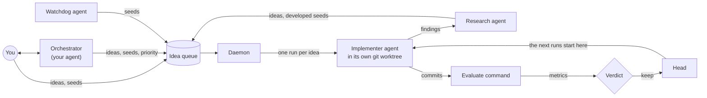
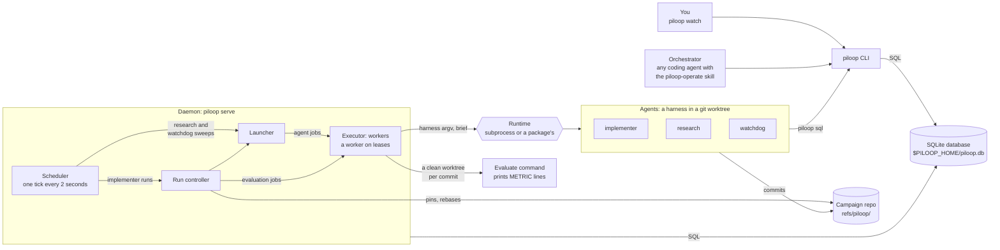

## The core idea

piloop is a daemon that manages a queue of ideas. Each idea becomes a **run**: a coding agent tries the idea in its own
git worktree and commits. The evaluate command measures each commit. The verdict keeps a commit only when it beats the
**head**, the best result so far. That is the whole loop.

piloop is an orchestrator on top of existing coding agents: Claude Code, Codex and pi. It is not a new agent harness.
The companies that train the models tune their own harnesses hard for this kind of work. piloop runs the harnesses as
they are, so it gets their best features at no cost.

The design optimizes three things, in this order:

1. **The best final result.** A commit is kept only when its gain is statistically real and every guardrail metric
   holds.
2. **Reaching that result fast.** The daemon runs the most urgent ideas first, several at a time.
3. **A short experiment loop.** Each run starts in a fresh worktree of the head. The implementer slot is free again as soon
   as the agent ends, while the daemon measures the commits.

The state is one SQLite file. Agents read and write it with plain SQL through `piloop sql`, and the skills use the
same CLI.

You do not manage a swarm of agents. You talk to one agent, the [orchestrator](/concepts/orchestrator), and it runs
piloop for you.

## Who adds ideas

Anyone can add to the queue. Each actor sees different information, so each one adds a different kind of idea.

| Actor | What it adds or changes | What it sees |
|---|---|---|
| You | Ideas and seeds. The priority and status of any idea. | Everything: `piloop watch`, `piloop status`, the inbox. |
| Orchestrator | Ideas and seeds. The priority and status of any idea. | The inbox and the campaign status. |
| Research | Develops each seed into an idea or rejects it. Adds ideas of its own, with a priority. | The campaign overview and the research pack: what was tried, by family, and every finding. |
| Watchdog | Seeds, for example a retry that avoids a failure. Escalations for the orchestrator. | The campaign overview, and the research pack or the incidents to investigate. |
| Implementer | A hunch in its `finding` comment. Research reads it. An implementer files no ideas or seeds. | Its brief: its idea, its starting point, the comments on the idea, and the history. |
| Daemon | Puts an idea back in the queue when its run failed and attempts are left. Files a seed when a rebase conflicts. Rejects an idea that a newer one supersedes before it ran. | The database. |

Research and the watchdog do not change the priority or the status of ideas that they did not file. The orchestrator
and you do. [Ideas, seeds and runs](/concepts/ideas-and-runs) has the details.

## The components

- **The CLI** (`piloop`) is how people and agents act: `piloop idea add`, `piloop sql`, `piloop inbox wait`,
  `piloop status`. See the [CLI reference](/reference/cli).
- **The database** is the contract between every actor. Its tables, CHECK constraints and triggers hold the rules:
  the allowed values, who changed a row last, a log of every change, and full-text search. An authorizer refuses
  schema changes and transactions from `piloop sql`. See the [data model](/architecture/data-model).
- **The daemon** (`piloop serve`) is one process for each piloop home. On each tick, the **scheduler** checks the
  triggers of every campaign, queues runs of ready ideas and launches the requested agents. The **run controller** runs
  one run: the agent, the scores, the verdict. The **launcher** hands every agent's job to the executor.
- **The executor** runs the jobs, in three layers:
  1. The executor itself is a [capability](/architecture/extension-points#executors) that you can swap.
  2. [Leases](/architecture/leases) are a library that an executor can use to hand jobs to workers.
  3. The built-in executor, `workers`, runs one worker on leases, in `piloop serve`. The worker makes the worktree,
     runs the agent or the evaluate command, and reports.
- **The [runtime](/concepts/roles#runtimes)** is where an agent process runs: a background process by default. A package can
  add others.
- **The harness** is the coding agent CLI: Claude Code, Codex or pi. A `[harness.<name>]` table says how to start it.
- **The agents** each work in their own git worktree. An implementer tries one idea. Research, the watchdog and the roles that
  you define are [sweeps](/concepts/roles) that read the state of the campaign and write ideas, seeds and comments.
- **The evaluate command** is your program. The daemon runs it in a clean worktree of each commit and stores what it
  prints as a measurement.
- **The orchestrator** is any coding agent with the `piloop-operate` skill. It loops on `piloop inbox wait`. The
  daemon never starts it.

With the built-in executor, everything runs on one machine: one SQLite file, one daemon, and local worktrees.

## What you can replace

A **capability** is a part of piloop that makes one kind of decision, for example which candidates to keep. Each
capability has a **built-in provider**: the implementation that piloop includes. You can select another provider in
the configuration, or add one with a plugin, a Python package that you install next to piloop.

| Part of piloop | Can you replace it? |
|---|---|
| The SQLite database and its log of events | No. |
| The plugin host: the part of piloop that loads plugins | No. |
| The interface of the CAS | No. A CAS provider can change where its blobs go. |
| The operations that apply a job's result | No. An executor calls them. |
| Each capability: executor, network, runtime, CAS, role, trigger, verdict rule, stop rule | Yes. |

## Read next

- [One run's life](/architecture/run-lifecycle): what happens between a ready idea and a verdict.
- [State machines](/architecture/state-machines): the statuses of ideas, runs, agents and candidates.
- [Code layout](/architecture/code-layout): the subpackages of `piloop` and how they depend on each other.
- [Extension points](/architecture/extension-points): every capability, and how to replace one, call a built-in
  provider, or declare your own.
