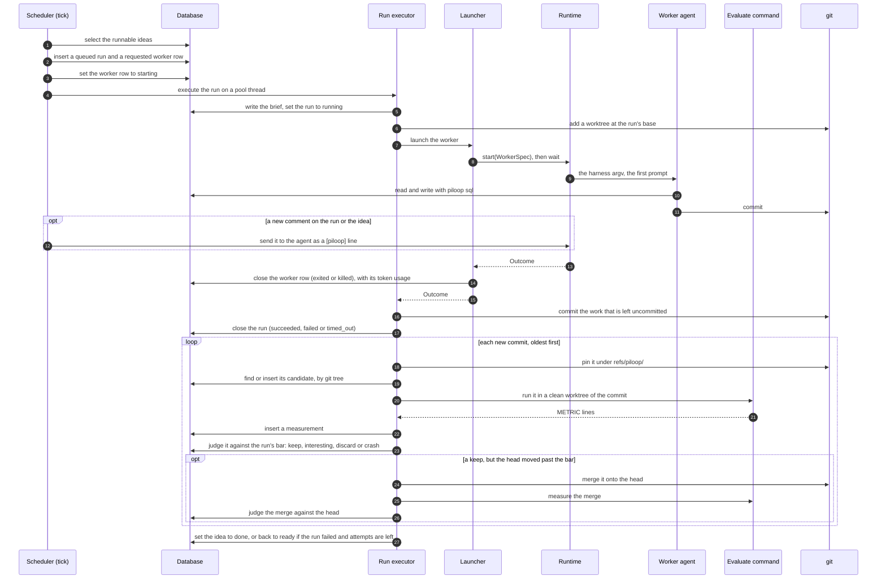

A **run** is one attempt at an idea. The scheduler queues it on a tick. A thread of the daemon then executes it:
the worktree, the agent, the scores and the verdicts. The code is in `piloop/daemon/scheduler.py` and
`piloop/daemon/runner.py`.

## The steps

1. **Queue.** On each tick, the scheduler fills the free worker slots with runnable ideas. An idea is runnable when
   it is `ready` and each of its prerequisites (an `after` link) is `done`. The slot goes to the most urgent idea of
   the track that is furthest below its share. At least one run in `[roles.worker] explore_every` starts from a
   pinned idea when one is ready. The scheduler inserts a `queued` run, chooses its harness from the rotation, and
   inserts a `requested` worker row. A [role that does runs](/concepts/roles#define-a-role-that-does-runs) fills its
   own slots in the same way, with the ideas that its `takes` condition selects, before the worker.
2. **Take.** In the same tick, the scheduler sets `requested` rows to `starting`, up to `max_concurrent` for each role
   and each harness. Each one goes to a thread of the daemon's pool.
3. **Launch.** The run executor writes the brief and adds a git worktree at the run's base: the head, or the
   candidate that the idea pins. The launcher fills in the harness's argv and calls `Runtime.start`.
4. **Work.** The agent reads its brief, implements the idea and commits. It reads and writes the database with
   `piloop sql`. On each tick, the scheduler sends new comments on the run or the idea to the agent.
5. **Close.** When the agent ends or times out, the launcher closes the worker row and reads its token usage. The
   executor commits what is left uncommitted, on its own, as a `recovered` commit, and closes the run. The worker
   slot is now free for the next run.
6. **Score.** Each new commit becomes a candidate. Commits with the same git tree are the same candidate. The daemon
   runs the evaluate command in a clean worktree of the commit, stores a measurement, and judges the candidate against
   the run's bar. A keep becomes the bar for the run's next commit. A `recovered` commit is not measured; if the run
   did not succeed, the idea goes back to the queue with it as its base, so a new worker finishes it.
7. **Rebase.** When a keep's bar is no longer the head, because another run kept meanwhile, the keep is marked
   `interesting`. The daemon merges it onto the head, measures the merge and judges it there. A merge that conflicts
   files a seed.
8. **Settle.** The idea becomes `done`, or goes back to `ready` when its run failed and it has attempts left. The
   idea stays `scheduled` until every commit is judged, so an idea that waits for it starts from its keeps.

An agent that does not start to work is not an attempt. The executor queues the run again with a new worker row, up
to two times. A run whose every agent failed to start parks its idea. [The verdict](/concepts/verdict) explains the bar, the head and the statistics.
