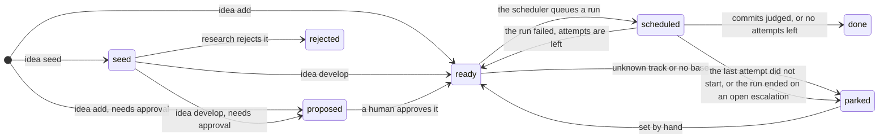
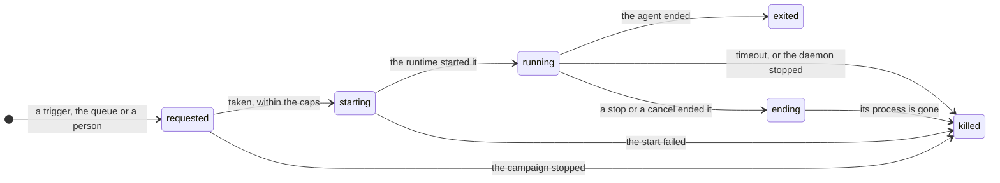
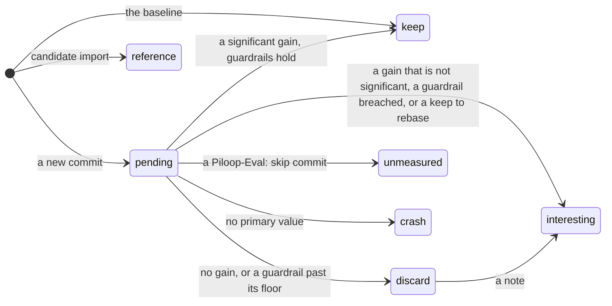

import States from '/snippets/generated/states.mdx';

Four columns hold a lifecycle: `ideas.status`, `runs.status`, `agent_sessions.state` and `candidates.verdict`. A CHECK
constraint fixes the set of values of each one. piloop has no table of allowed transitions: the daemon and the CLI
take the paths below. Anyone with `piloop sql` can set any value, for example to park an idea or to change a verdict.

These are the values, generated from the enums in `piloop/db/models.py`:

<States />

## Idea

A newer idea that `supersedes` a `seed`, `proposed` or `ready` idea that never ran makes the daemon reject it. You,
the orchestrator and research also park or reject ideas by hand. See [Ideas, seeds and runs](/concepts/ideas-and-runs).

## Run

```mermaid
stateDiagram-v2
    direction LR
    [*] --> queued: the scheduler queues it
    queued --> running: the executor starts it
    running --> queued: its agent did not start, relaunch
    running --> succeeded: commits or a finding
    running --> failed: no finding and an error, no commit, or the daemon stopped; or an open escalation
    running --> timed_out: the role timeout, without a finding
    queued --> failed: the campaign or the daemon stopped
```

`runs.end` says how a finished run ended, and `runs.error` gives the detail. Only `finished`, `failed`, `timed_out`
and `awaiting_answer` are attempts at the idea: a run that the daemon, a stop or a cancel ended is not. Its idea goes
back to `ready`. A run whose implementer had
left its finding before the stop is not stopped: it is finished. The stop closes it as `succeeded`, its idea stays
`scheduled`, and the next daemon scores its commits and settles the idea. The same holds when such an implementer times
out, because a job of its own keeps the run open, or exits with an error: the run `succeeded`, the idea is `done`,
and the agent session row keeps the error.

An implementer that stops while its own escalation waits for an answer ends its run `awaiting_answer`, and the error
names the escalation. Its idea is `parked` until someone answers and sets it `ready`.

## Agent

A `agent_sessions` row is an agent process of any role. While it is `requested`, the row is a request to start one.

From `ending` on, a finding that the agent writes is refused, so it cannot settle a run that a stop or a cancel ended.

## Candidate verdict

The daemon sets a verdict once. Anyone may change it later, and should say why in a comment. See
[the verdict](/concepts/verdict).
