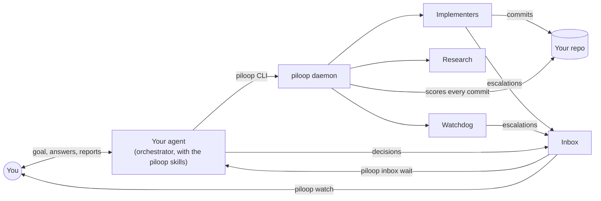
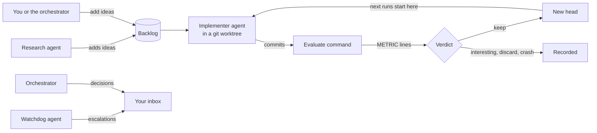

piloop is an autoresearch tool for any git repo. You tell one coding agent what to improve, in plain words. That agent
sets up a campaign in your repo and runs it for you. Other coding agents try ideas in parallel, each one in its own
git worktree. piloop scores every commit with your evaluate command. It keeps a change only when the change beats the
best result so far. When your evaluate command reports a result for each example, the gain must also hold with
statistical confidence.

The design is simple on purpose. piloop is a daemon that manages a queue of ideas. Each idea becomes a run: a coding
agent tries it in its own worktree, the evaluate command measures the commit, and the verdict keeps it only if it
beats the head, the best result so far. piloop does not bring its own agent. It runs Claude Code, Codex and pi as
they are. The state is one SQLite file that every agent reads and writes with plain SQL. The
[architecture overview](/architecture/overview) has the details.

The enwik8 example after 10 implementer runs: Claude Code agents took the first 10 MB of Wikipedia from 3,688,770 bytes (zlib) to 2,361,893 bytes (−36%) in 1.6 hours. Every number on this screen is from that run.

## You talk to one agent

- **You** open your coding agent in your repo and say what to improve. You answer a short interview. After that, you
  only answer what needs you.
- **Your agent** is Claude Code, Codex, pi, Gemini CLI or Cursor, with the piloop skills. It sets up the campaign,
  starts the daemon and then orchestrates: it watches the inbox, decides escalations and records each decision in your
  inbox. It can run one campaign or [several](/several-campaigns).
- **The piloop daemon** starts implementer, research and watchdog agents. It scores every commit and gives it a verdict.
- **The inbox** holds the escalations and every decision that your agent took for you. You review it when you want,
  in `piloop watch` or through your agent.

The `piloop` CLI, `piloop.toml` and `piloop watch` are the tools that your agent uses. You can use them too, but you
do not have to.

## Why piloop

A coding agent can try an idea in minutes. A hundred ideas need bookkeeping: which idea ran on which code, what it
scored, and whether the gain is real or noise. piloop does this bookkeeping for you.

- **Every commit is scored.** piloop runs your evaluate command in a clean checkout of each commit, so an agent does
  not report its own score. Keep the evaluate command out of the files that the agents may change (see
  [the evaluate command](/concepts/campaigns#the-evaluate-command)).
- **A gain must be real.** piloop compares each result with the best one so far. When your evaluate command reports
  results per example, piloop uses a paired bootstrap, so a gain that comes from a few lucky examples is not kept.
- **Guardrails are enforced.** A second metric, such as latency or size, can get worse only by a margin that you set,
  and never past a floor.
- **Agents work in parallel.** Each implementer has its own worktree. A research agent keeps the backlog full. A watchdog
  agent looks for problems.
- **You do not have to wait at the screen.** Your agent answers what the other agents escalate. It records each
  decision in your inbox, so you can review and revert it later.
- **Your state stays local.** The state is a SQLite database and the run directories in `PILOOP_HOME`
  (`~/.piloop` by default), and the git refs in your repo. piloop has no hosted service and no account. The coding
  agents send your code and their prompts to their model providers, as they do when you use them yourself.

## How a campaign works

1. You, the orchestrator or the research agent add **ideas** to the backlog of the **campaign**.
2. The daemon, `piloop serve`, starts an **implementer** for each ready idea, up to a limit that you set. Each implementer is a
   coding agent in a git worktree of the **head**, the best result so far.
3. The implementer implements the idea and commits.
4. The daemon runs the **evaluate command** in a clean worktree of each commit. The command prints one
   `METRIC <name>=<value>` line for each metric.
5. The daemon gives the commit a **verdict**: `keep`, `interesting`, `discard` or `crash`. A `keep` becomes the new
   head, and the next runs start from it.
6. The **watchdog** looks for problems. The **research** agent adds ideas when the backlog is short. The
   **orchestrator** answers escalations and records each decision in your **inbox**.

## Requirements

- Linux or macOS.
- git 2.40 or later, with a commit identity (`git config user.email`).
- [uv](https://docs.astral.sh/uv/). The installer installs it.
- At least one implementer agent CLI, logged in: [Claude Code](https://code.claude.com),
  [Codex](https://github.com/openai/codex) or [pi](https://github.com/badlogic/pi-mono). The agent that you talk to
  can also be Gemini CLI or Cursor.
- Optional: [Herdr](https://herdr.dev), to see and steer every agent in a terminal pane. By default, the agents run
  in the background. To use Herdr, set `runtime = "herdr"`.
- Optional: [Entire](https://github.com/entireio/cli), to keep the session of every agent in your repo.

## Next steps

<CardGroup cols={2}>
  <Card title="Quickstart" icon="rocket" href="/quickstart">
    Install piloop, open your agent and describe the problem.
  </Card>
  <Card title="Several campaigns" icon="layer-group" href="/several-campaigns">
    One agent runs a campaign in each of your repos.
  </Card>
  <Card title="Run a campaign by hand" icon="terminal" href="/by-hand">
    The same steps without an agent, on the enwik8 example or your own repo.
  </Card>
  <Card title="Concepts" icon="book" href="/concepts/campaigns">
    Campaigns, ideas, runs, candidates and the verdict.
  </Card>
</CardGroup>
