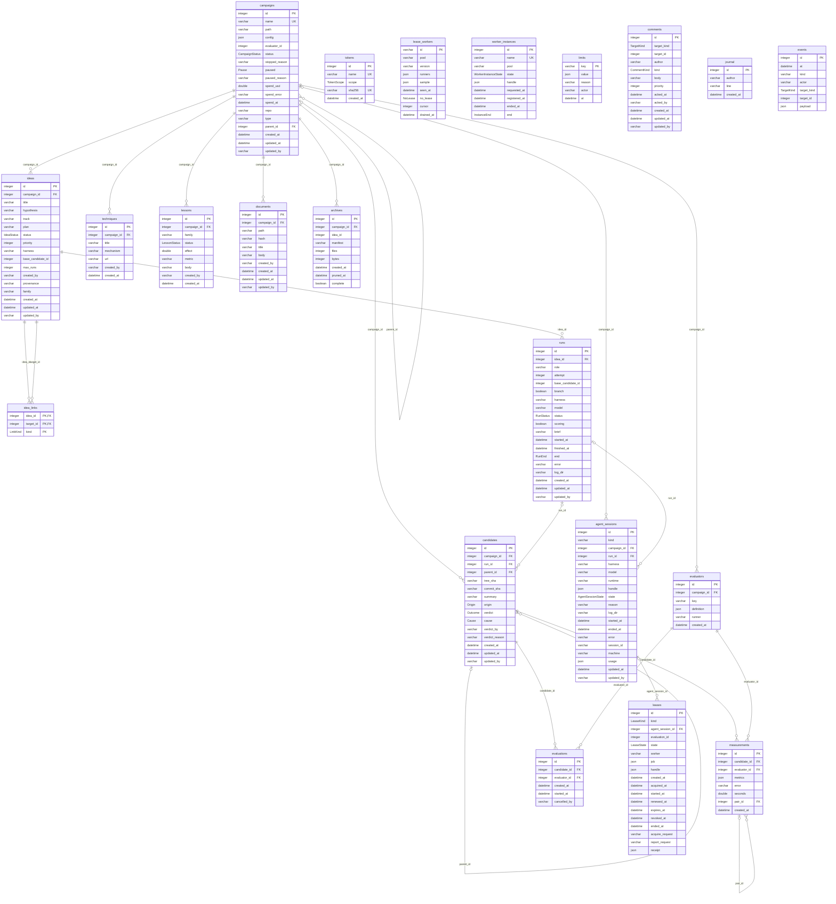

{/* WARNING: This file is auto-generated (uv run -m scripts.generate_all). Update the models in `piloop/db/models.py` if you want to change anything here. */}

The full-text indexes are not in the diagram: `ideas_fts` (`title`, `hypothesis`, `plan`), `comments_fts` (`body`), `documents_fts` (`title`, `body`).
