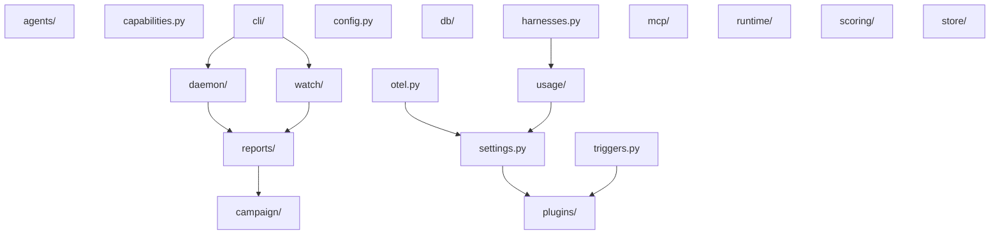

{/* WARNING: This file is auto-generated (uv run -m scripts.generate_all). Update the imports of the modules in `piloop/` if you want to change anything here. */}

The graph leaves out the shared modules `actor.py`, `deprecated.py`, `git.py`, `proc.py`, `text.py`, `version.py`. Every layer may import them.

| Subpackage or module | Imports directly |
|---|---|
| `actor.py` | nothing |
| `agents/` | `actor.py`, `config.py`, `db/`, `deprecated.py`, `harnesses.py`, `otel.py`, `plugins/`, `proc.py`, `runtime/`, `scoring/`, `settings.py`, `text.py`, `usage/` |
| `campaign/` | `actor.py`, `agents/`, `config.py`, `db/`, `deprecated.py`, `git.py`, `plugins/`, `proc.py`, `scoring/`, `settings.py`, `store/`, `text.py`, `usage/` |
| `capabilities.py` | `config.py`, `harnesses.py`, `mcp/`, `otel.py`, `plugins/`, `proc.py`, `runtime/`, `settings.py`, `store/`, `triggers.py`, `usage/` |
| `cli/` | `actor.py`, `agents/`, `campaign/`, `config.py`, `daemon/`, `db/`, `deprecated.py`, `git.py`, `harnesses.py`, `mcp/`, `plugins/`, `proc.py`, `reports/`, `runtime/`, `scoring/`, `settings.py`, `store/`, `text.py`, `version.py`, `watch/` |
| `config.py` | `actor.py`, `db/`, `deprecated.py`, `harnesses.py`, `mcp/`, `plugins/`, `triggers.py` |
| `daemon/` | `actor.py`, `agents/`, `campaign/`, `config.py`, `db/`, `deprecated.py`, `git.py`, `harnesses.py`, `otel.py`, `plugins/`, `proc.py`, `reports/`, `runtime/`, `scoring/`, `settings.py`, `store/`, `text.py`, `triggers.py`, `usage/` |
| `db/` | `actor.py`, `deprecated.py`, `git.py`, `proc.py`, `version.py` |
| `deprecated.py` | `actor.py`, `version.py` |
| `git.py` | nothing |
| `harnesses.py` | `mcp/`, `usage/` |
| `mcp/` | nothing |
| `otel.py` | `settings.py` |
| `plugins/` | `agents/`, `config.py`, `db/`, `deprecated.py`, `git.py`, `harnesses.py`, `mcp/`, `otel.py`, `proc.py`, `runtime/`, `scoring/`, `store/`, `usage/` |
| `proc.py` | nothing |
| `reports/` | `actor.py`, `agents/`, `campaign/`, `config.py`, `db/`, `deprecated.py`, `git.py`, `plugins/`, `runtime/`, `scoring/`, `text.py`, `usage/` |
| `runtime/` | `db/`, `deprecated.py`, `harnesses.py`, `plugins/`, `proc.py`, `settings.py` |
| `scoring/` | `actor.py`, `config.py`, `db/`, `git.py`, `plugins/`, `proc.py`, `text.py` |
| `settings.py` | `actor.py`, `deprecated.py`, `plugins/` |
| `store/` | `plugins/`, `settings.py` |
| `text.py` | nothing |
| `triggers.py` | `db/`, `plugins/` |
| `usage/` | `db/`, `settings.py` |
| `version.py` | nothing |
| `watch/` | `actor.py`, `campaign/`, `config.py`, `db/`, `reports/`, `runtime/`, `scoring/`, `text.py`, `usage/` |
