{/* WARNING: This file is auto-generated (uv run -m scripts.generate_all). Update the imports of the modules in `piloop/` if you want to change anything here. */}

```mermaid
flowchart TB
    agents["agents/"]
    api["api/"]
    campaign["campaign/"]
    capabilities["capabilities.py"]
    cli["cli/"]
    config["config.py"]
    daemon["daemon/"]
    db["db/"]
    deprecated["deprecated.py"]
    harnesses["harnesses.py"]
    mcp["mcp/"]
    net["net/"]
    otel["otel.py"]
    plugins["plugins/"]
    reports["reports/"]
    runtime["runtime/"]
    scoring["scoring/"]
    settings["settings.py"]
    store["store/"]
    usage["usage/"]
    watch["watch/"]
    api --> plugins
    deprecated --> plugins
    otel --> settings
```

The graph leaves out the shared modules `actor.py`, `ids.py`, `proc.py`, `text.py`, `version.py`. Every layer may import them.

| Subpackage or module | Imports directly |
|---|---|
| `actor.py` | `ids.py` |
| `agents/` | `actor.py`, `config.py`, `db/`, `deprecated.py`, `harnesses.py`, `ids.py`, `otel.py`, `plugins/`, `scoring/`, `settings.py`, `store/`, `usage/` |
| `api/` | `actor.py`, `ids.py`, `mcp/`, `plugins/`, `text.py` |
| `campaign/` | `actor.py`, `agents/`, `api/`, `config.py`, `db/`, `deprecated.py`, `ids.py`, `plugins/`, `proc.py`, `scoring/`, `settings.py`, `store/`, `text.py` |
| `capabilities.py` | `actor.py`, `api/`, `daemon/`, `db/`, `ids.py`, `mcp/`, `net/`, `otel.py`, `plugins/`, `proc.py`, `runtime/`, `store/`, `usage/` |
| `cli/` | `actor.py`, `agents/`, `api/`, `campaign/`, `config.py`, `daemon/`, `db/`, `deprecated.py`, `harnesses.py`, `ids.py`, `mcp/`, `net/`, `otel.py`, `plugins/`, `proc.py`, `reports/`, `scoring/`, `settings.py`, `store/`, `text.py`, `version.py`, `watch/` |
| `config.py` | `deprecated.py`, `harnesses.py`, `ids.py`, `mcp/`, `plugins/` |
| `daemon/` | `actor.py`, `agents/`, `api/`, `campaign/`, `config.py`, `db/`, `deprecated.py`, `harnesses.py`, `ids.py`, `mcp/`, `net/`, `otel.py`, `plugins/`, `proc.py`, `reports/`, `runtime/`, `scoring/`, `settings.py`, `text.py`, `usage/`, `version.py` |
| `db/` | `actor.py`, `api/`, `config.py`, `deprecated.py`, `ids.py`, `otel.py`, `plugins/`, `proc.py`, `usage/`, `version.py` |
| `deprecated.py` | `plugins/`, `version.py` |
| `harnesses.py` | `deprecated.py`, `mcp/`, `usage/` |
| `ids.py` | nothing |
| `mcp/` | nothing |
| `net/` | `actor.py`, `api/`, `db/`, `deprecated.py`, `plugins/`, `settings.py` |
| `otel.py` | `settings.py` |
| `plugins/` | `actor.py`, `agents/`, `api/`, `campaign/`, `cli/`, `config.py`, `daemon/`, `db/`, `deprecated.py`, `harnesses.py`, `ids.py`, `mcp/`, `net/`, `otel.py`, `proc.py`, `reports/`, `runtime/`, `scoring/`, `settings.py`, `store/`, `text.py`, `usage/` |
| `proc.py` | nothing |
| `reports/` | `actor.py`, `agents/`, `api/`, `campaign/`, `config.py`, `db/`, `ids.py`, `plugins/`, `runtime/`, `scoring/`, `store/`, `text.py`, `usage/` |
| `runtime/` | `db/`, `plugins/`, `settings.py` |
| `scoring/` | `actor.py`, `api/`, `config.py`, `db/`, `ids.py`, `plugins/`, `proc.py`, `text.py` |
| `settings.py` | `actor.py`, `deprecated.py`, `plugins/` |
| `store/` | `deprecated.py`, `plugins/` |
| `text.py` | nothing |
| `usage/` | `db/`, `deprecated.py`, `ids.py`, `settings.py` |
| `version.py` | nothing |
| `watch/` | `actor.py`, `agents/`, `api/`, `campaign/`, `config.py`, `db/`, `ids.py`, `plugins/`, `reports/`, `scoring/`, `text.py`, `usage/` |
